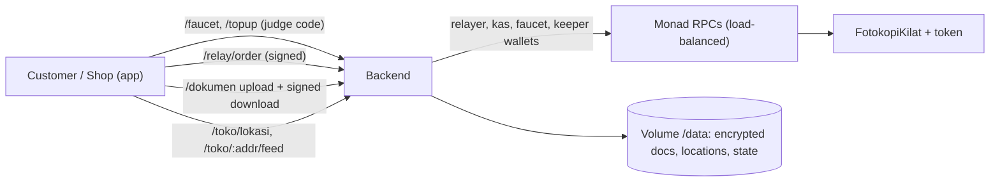

# PrintPitt · backend

One Node service (Railway, no database, files on a volume) that makes PrintPitt usable without crypto knowledge: free gas, Rupiah vouchers, gasless orders, encrypted documents and a nearby-shop feed.



| Module | What it does |
|---|---|
| Faucet | sends MON for gas once per address; access code + total cap; respects Monad's 10 MON reserve |
| Top-up | `simulasi` / `voucher` (free Rupiah from a kas wallet with a code) / `live` IDRX API |
| Relayer | submits signed orders (EIP-712 + permit) so customers need no MON |
| Keeper | expires stale orders, closes unpicked-up orders and stale disputes |
| Documents | AES-256-GCM, only the winning shop or the customer can download (EIP-191 signature), auto-deleted |
| Radius feed | rounded locations, 1.5 km (3 km Toko Pro) |

Live: testnet `https://backend-production-2b31.up.railway.app` · mainnet `https://backend-mainnet-production-7835.up.railway.app` (`/config`, `/status`).

Tests: `npm test` (anvil e2e), `npm run test:voucher`, `test:testnet`, `test:beban` (load test), `test:mainnet` (costs real MON). Secrets only in Railway variables; see `.env.example`.

Related repos: [contracts](https://github.com/PrintPitt/contracts) · [indexer](https://github.com/PrintPitt/indexer) · [frontend](https://github.com/PrintPitt/frontend) · [vault](https://github.com/PrintPitt/vault)

---

# PrintPitt · backend

Satu service Node (`node:http`, tanpa database) untuk Railway: faucet MON, top-up Rupiah → tIDRX (simulasi API mint IDRX),
relayer pesanan tanpa gas, keeper `expire`, order bot, dan status. Spesifikasi lengkap: repo `PrintPitt/vault` →
`04-Architecture/Desain Backend.md`.

## Jalankan

```bash
npm install
cp .env.example .env     # isi nilai lokal; di Railway isi lewat Variables, jangan commit
npm start                # node src/server.ts (Node >= 23.6)
```

## Uji lokal (anvil)

Butuh Foundry dan repo `PrintPitt/contracts` di sebelah repo ini (atau set `CONTRACTS_DIR`).

```bash
npm test                 # anvil → deploy → service → 35 pengecekan
```

## `@printpitt/shared`

Dipasang dari `vendor/printpitt-shared-*.tgz`, supaya build Railway tidak butuh akses ke repo private lain.
Setelah ABI/alamat berubah di repo contracts: `npm run sync-shared`, lalu commit `vendor/` dan `package-lock.json`.

## Deploy

`railway.json` + `Dockerfile` di root. Replika harus 1 (antrean nonce ada di memori).
