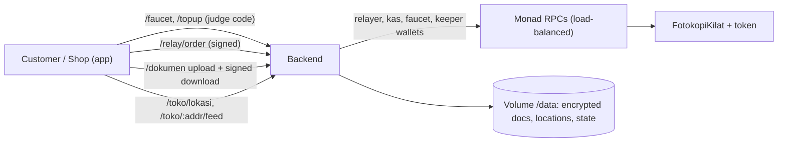

# PrintPitt · backend

One Node service (Railway, no database, files on a volume) that makes PrintPitt usable without crypto knowledge: free gas, Rupiah vouchers, gasless orders, encrypted documents and a nearby-shop feed.

## For judges: check it in 2 minutes

- **Live config (mainnet):** https://backend-mainnet-production-7835.up.railway.app/config shows the chain, contract, token, fees and voucher mode.
- **Live status:** https://backend-mainnet-production-7835.up.railway.app/status shows wallet balances, faucet usage, vouchers claimed, keeper and relayer counters.
- **Try it as a user:** open https://printpitt-app.vercel.app and enter the judge code from our pitch. The backend gives you gas and a Rupiah voucher, and submits your order without you paying gas.
- **Proof it works end to end on mainnet:** `npm run test:mainnet` passed 19/19. It covers shop self-registration, voucher, encrypted document, gasless order, radius feed, claim, document download, QR handover, NFT and platform fee.

## Endpoints

| Method + path | Body | Purpose |
|---|---|---|
| `GET /health` | | liveness |
| `GET /config` | | addresses, fees, top-up mode, radius |
| `GET /status` | | balances and counters |
| `POST /faucet` | `{ address, kode }` | MON for gas, once per new address (`BAD_CODE`, `ALREADY_FUNDED`, `FAUCET_LIMIT`, `FAUCET_EMPTY`) |
| `POST /topup` | voucher: `{ destinationWalletAddress, kode }` · simulasi: `{ toBeMinted, destinationWalletAddress, paymentMethod, channelId }` | Rupiah top-up (`ALREADY_CLAIMED`, `VOUCHER_HABIS`) |
| `GET /topup/:id` · `POST /topup/:id/bayar` · `GET /bayar/:id` | | status · simulated payment · simulated checkout page |
| `POST /relay/order` | `{ pesanan, sig, izin }` | gasless order (`PENDING_ORDER`, contract error names such as `BadSignature`) |
| `POST /dokumen` | raw PDF/PNG/JPEG, header `x-nama-file` | encrypted upload → `{ dokumen, halaman }` |
| `GET /dokumen/:hash` · `POST /dokumen/:hash/unduh` | `{ orderId, alamat, waktu, sig }` | info · signed download (winning shop or customer only) |
| `POST /toko/lokasi` · `POST /order/:id/lokasi` | `{ lat, lng, waktu, sig, … }` | shop and order location (rounded, signed) |
| `GET /toko/:alamat/feed` | `?semua=1` | open orders within radius, nearest first |
| `POST /admin/bot` | `Authorization: Bearer <ADMIN_TOKEN>` | order bot on/off |

## Key environment variables

| Variable | Purpose |
|---|---|
| `RPC_URL` | one or more RPC URLs (comma-separated), load-balanced, limited by `RPC_RPS` (Monad public RPC: 15 req/s per IP) |
| `FAUCET_PRIVATE_KEY`, `RELAYER_PRIVATE_KEY`, `KEEPER_PRIVATE_KEY`, `MINTER_PRIVATE_KEY` (kas), `BOT_PRIVATE_KEY` | one wallet per role. **Secrets: Railway only, piped with `--stdin`** |
| `FAUCET_AMOUNT`, `FAUCET_MIN_BALANCE` (≥ 10.5, Monad reserve), `FAUCET_KODE`, `FAUCET_MAX_TOTAL` | faucet rules |
| `IDRX_MODE` (`simulasi`/`voucher`/`live`), `TOPUP_VOUCHER_RP`, `TOPUP_KODE` | top-up mode |
| `DATA_DIR`, `DOKUMEN_KEY`, `DOKUMEN_MAX_MB`, `DOKUMEN_TTL_MENIT` | encrypted document storage |
| `RADIUS_KM`, `RADIUS_PRO_KM`, `ALLOWED_ORIGIN`, `RATE_LIMIT_PER_MIN`, `ADMIN_TOKEN`, `KEEPER`, `BOT` | feed, CORS, abuse limits, background jobs |

Full list with defaults: `.env.example`. Deploy: Railway, `numReplicas: 1` (the nonce queue is in memory), volume at `/data` with `RAILWAY_RUN_UID=0`.

## Glossary

| Term | Meaning |
|---|---|
| `kas` | voucher wallet holding Rupiah tokens |
| `kode` (juri) | judge access code for the faucet and voucher |
| `pesanan` / `izin` | signed order / token permit |
| `dokumen`, `lokasi`, `toko`, `antrean` | document, location, shop, transaction queue |

## How it works

| Module | What it does |
|---|---|
| Faucet | sends MON for gas once per address; access code + total cap; respects Monad's 10 MON reserve |
| Top-up | `simulasi` / `voucher` (free Rupiah from a kas wallet with a code) / `live` IDRX API |
| Relayer | submits signed orders (EIP-712 + permit) so customers need no MON |
| Keeper | expires stale orders, closes unpicked-up orders and stale disputes |
| Documents | AES-256-GCM, only the winning shop or the customer can download (EIP-191 signature), auto-deleted |
| Radius feed | rounded locations, 1.5 km (3 km Toko Pro) |

Live: testnet `https://backend-production-2b31.up.railway.app` · mainnet `https://backend-mainnet-production-7835.up.railway.app` (`/config`, `/status`).

Tests: `npm test` (anvil e2e), `npm run test:voucher`, `test:testnet`, `test:beban` (load test), `test:mainnet` (costs real MON). Secrets only in Railway variables; see `.env.example`.

Related repos: [contracts](https://github.com/PrintPitt/contracts) · [indexer](https://github.com/PrintPitt/indexer) · [frontend](https://github.com/PrintPitt/frontend)
